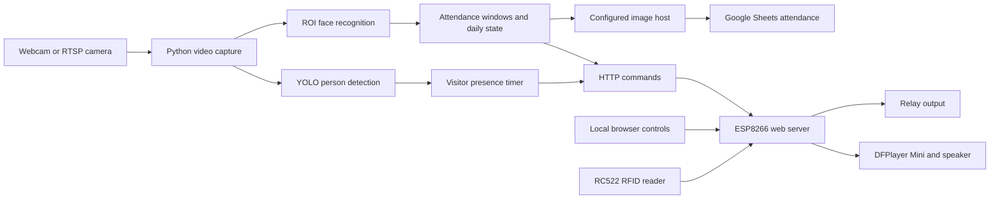

# AI Gate Control and Attendance System

**Computer vision, RFID access, and cloud attendance logging connected through Python and an ESP8266.**

This project connects a camera-based recognition application to a microcontroller that handles relay commands, RFID cards, and audio feedback. It demonstrates integration across vision processing, attendance state, HTTP device communication, and Google APIs.

**Status:** development prototype for a controlled demonstration. The firmware accepts unauthenticated HTTP commands, and face matching has no liveness detection. Begin on an isolated network with the actual lock disconnected.

[Architecture](#architecture) · [Setup](#setup) · [Hardware](#hardware) · [Configuration](#configuration) · [Troubleshooting](#troubleshooting) · [Limitations](#limitations-and-next-steps)

## What it demonstrates

- **Face recognition:** matches enrolled faces inside an adjustable region of interest using `face_recognition`/dlib.
- **Visitor presence:** uses YOLOv8 person detection to trigger a separate visitor audio notification.
- **Attendance workflow:** distinguishes on-time check-in, late check-in, and check-out, with local daily state and Google Sheets records.
- **Image evidence:** crops recognition snapshots and uploads them through one configured image-hosting backend.
- **Device integration:** queues HTTP audio commands and sends named relay commands to an ESP8266.
- **RFID access:** stores a master card and an authorized-card list in EEPROM.
- **Local controls:** provides an OpenCV recognition window and an ESP8266 browser dashboard.

YOLO detects presence; it does not identify people or act as a prerequisite for face recognition. RFID access runs on the microcontroller and does not create Google Sheets attendance records.

## Architecture



| Component | Responsibility |
| --- | --- |
| Python application | Captures frames, detects faces/people, applies attendance rules, uploads snapshots, and sends device commands |
| ESP8266 firmware | Serves the control page, handles RFID/EEPROM, plays indexed audio, and pulses the relay |
| Google Sheets | Stores per-person, per-date attendance rows and image formulas |
| Image backend | Supplies an image URL through ImgBB, Imgur, or Google Drive |

### Event behavior

| Event | Current behavior |
| --- | --- |
| First recognized check-in that day | After three recognition observations, attempts image upload and sheet logging; on success, saves daily state and sends configured check-in audio and a relay request |
| First recognized check-out | After recognition confirmation, attempts image upload and sheet logging, then saves state and queues configured check-out audio; this first check-out path does not trigger the relay |
| Person already recorded for that attendance action | Sends the generic person endpoint again; the matching firmware route can play audio and pulse the relay |
| Recognized person outside attendance windows | Sends the generic person endpoint after a per-person cooldown, without a new attendance record |
| Person detected without a recognized face | Attempts a visitor audio notification after the configured presence interval; no attendance row or relay command is requested |
| Authorized RFID card | Plays the success sound and pulses the relay locally; Python and Google Sheets are not involved |

First-time attendance completion depends on successful image hosting and sheet logging. Local daily status is a duplicate-suppression record, not an offline attendance queue.

## Repository layout

```text
.
├── python/
│   ├── main.py                       # Vision, attendance, uploads, and HTTP commands
│   ├── config.py.example             # Copy to a private local config.py
│   ├── service_account.json.example  # Credential structure example, not a usable key
│   └── requirements.txt              # Python dependencies
├── arduino/
│   └── ESP8266_Access_Control/
│       └── ESP8266_Access_Control.ino # RFID, relay, audio, and web controls
├── .gitignore
└── LICENSE
```

You supply the real configuration, Google key, enrollment images, audio tracks, and hardware. Model weights can be downloaded by Ultralytics on first use. Those local assets are not included in the repository.

## Setup

### 1. Prepare the Python environment

Use a desktop Python environment with OpenCV GUI support and a working camera. `face_recognition` depends on dlib, which may require native compiler tools. Package versions and a tested Python/OS combination are not locked in this repository.

```bash
git clone https://github.com/AimanRosman/AI-Gate-Control-and-Attendance-System.git
cd AI-Gate-Control-and-Attendance-System
python -m venv .venv
```

Activate the environment using the command for your shell:

| Shell | Command |
| --- | --- |
| Windows PowerShell | `.\.venv\Scripts\Activate.ps1` |
| macOS/Linux shell | `source .venv/bin/activate` |

Then install the dependencies:

```bash
python -m pip install -r python/requirements.txt
```

The application uses OpenCV, NumPy, PyTorch, Ultralytics, `face_recognition`, Requests, gspread, oauth2client, and the Google API Python client. A compatible CUDA installation is optional; the code selects it for YOLO when PyTorch reports CUDA availability.

### 2. Create local configuration

Copy [python/config.py.example](python/config.py.example) to `python/config.py`. Configure the camera, device address, attendance windows, Google Sheet, and one image-upload backend. See [Configuration](#configuration) for the relevant settings.

Use `CAMERA_URL = 0` to attempt a local webcam, or provide your own private stream URL. The capture class requests the FFmpeg backend, so camera/backend compatibility needs checking on the target OS. No working camera address or credentials are included.

### 3. Configure Google Sheets and image hosting

1. Enable the Google Sheets and Drive APIs in your Google Cloud project.
2. Create a service account and save its actual key as `python/service_account.json`. The `.example` file documents the expected structure; it cannot authenticate.
3. Share the target spreadsheet with the service account's email, granting the access needed to update attendance.
4. Set `SPREADSHEET_NAME` to the spreadsheet title. The application opens its **first worksheet**.
5. Add these exact headers in row 1, one header per column from A through G, in this order:

```text
Date | Name | Check-in Time | Status | Check-out Time | Check-in Image | Check-out Image
```

Keep the order: newly appended rows use this fixed layout. Images are stored as Google Sheets `IMAGE()` formulas referencing the uploaded URL.

Choose one backend:

| Backend | Configuration |
| --- | --- |
| ImgBB | `USE_IMGBB = True` and a local `IMGBB_API_KEY` |
| Imgur | `USE_IMGUR = True` and a local `IMGUR_CLIENT_ID` |
| Google Drive | `USE_SHARED_DRIVE = True`; configure access and the appropriate `GOOGLE_DRIVE_FOLDER_ID` / `SHARED_DRIVE_ID` values |

Set the other backend flags to `False`. If several are enabled, the code selects ImgBB first, then Imgur, then Drive. This is priority selection, not automatic failover. Google Sheets credentials are required whichever image backend is selected.

**Image privacy:** the Drive upload code grants `anyone` reader access. The other upload paths also return externally hosted image links. Review permissions, consent, and retention before using identifiable people; use consented demonstration images while evaluating the project.

### 4. Enroll faces and align device routes

Create your enrollment folders locally:

```text
python/known_faces/
├── Admin1/
│   ├── sample-01.jpg
│   └── sample-02.png
└── Admin2/
    └── sample-01.jpg
```

Use clear, consented `.jpg`, `.jpeg`, or `.png` images containing the intended face. Encodings are generated when the Python application starts; restart it after changing the enrollment images.

Folder names are normalized with `capitalize()` and lowercased for device requests. For example, `Admin1` becomes `Admin1` in attendance and `admin1` in HTTP paths.

- The supplied firmware provides generic routes for `admin1` through `admin6` and `boss`.
- Check-in/check-out audio routes exist only for `admin1` through `admin4`.
- Set `ADMINS_WITH_AUDIO` to matching normalized names, such as `["Admin1", "Admin2"]`. The template's `User1`/`User2` examples do not match the supplied firmware routes. This setting selects audio; it is not an authorization allowlist.
- Adding a new face folder alone does not add firmware endpoints. Update the firmware route/audio mapping when using other names.

### 5. Prepare and flash the ESP8266

1. Review the [hardware assignments](#hardware), especially the serial-pin conflict, before connecting peripherals.
2. Install ESP8266 board support in Arduino IDE and the `MFRC522` library. SPI, EEPROM, Wi-Fi, web server, and SoftwareSerial come from the board environment. DFPlayer commands are assembled directly; a DFPlayer library is not imported.
3. Open [ESP8266_Access_Control.ino](arduino/ESP8266_Access_Control/ESP8266_Access_Control.ino) and select a board with the expected `D0`–`D8` aliases.
4. Set the placeholder Wi-Fi fields in your local sketch and review relay polarity. This sketch is tracked: keep configured copies private and check your diff before committing.
5. Supply the audio tracks for the actions you use, and confirm playback indices against the `AUDIO_*` constants.
6. Upload the firmware. Open its serial monitor at **115200 baud** and copy the device address into `ESP8266_IP` in the private Python configuration.
7. Open `http://<device-address>/` on the isolated network and verify commands with an unloaded relay before running recognition.

Firmware initialization waits for Wi-Fi to connect before initializing RFID and relay control. There is no validated offline startup mode.

### 6. Run the application

With the virtual environment active, launch from `python/` so configuration and data paths resolve:

```bash
cd python
python main.py
```

Startup loads face encodings, initializes `yolov8n.pt`, attempts the configured camera, and falls back to camera `0` if opening fails. The OpenCV window shows the ROI, recognition labels, person boxes, and presence/cooldown indicators.

| Control | Action |
| --- | --- |
| Left-click and drag | Set a rectangular ROI in the displayed image |
| `q` | Exit the application |
| Device browser dashboard | Send firmware commands independently of Python |

Changing the ROI also clears the local day's check-in/check-out lists and recognition cooldown state. It does not delete existing spreadsheet rows. ROI changes affect the running configuration; they are not written back to `config.py`.

## Hardware

The design uses an ESP8266 board, RC522 reader, relay module, and optional DFPlayer Mini with speaker/microSD. The Python host supplies the camera-processing workload. Match power, logic levels, and relay polarity to the actual hardware; a complete tested wiring schematic is not supplied.

The following GPIO mapping assumes NodeMCU-style aliases:

| Connection | Board alias / GPIO | Notes |
| --- | --- | --- |
| Relay signal | D1 / GPIO 5 | Active-high by default; five-second pulse |
| RC522 reset | D0 / GPIO 16 | `RST_PIN` |
| RC522 SS/SDA | D8 / GPIO 15 | SPI chip select, not I2C SDA |
| RC522 SCK | D5 / GPIO 14 | Default SPI clock |
| RC522 MISO | D6 / GPIO 12 | Default SPI MISO |
| RC522 MOSI | D7 / GPIO 13 | Default SPI MOSI |
| DFPlayer TX → ESP receive | GPIO 3 | `DFPLAYER_RX` |
| ESP transmit → DFPlayer RX | GPIO 1 | `DFPLAYER_TX` |

The inline GPIO comments beside `D0`/`D1` in the sketch do not match NodeMCU aliases; the table follows the actual aliases. GPIO 3/1 also serve the normal programming/debug UART. Resolve or explicitly validate that conflict before using serial diagnostics and DFPlayer together. Check boot-pin constraints for the selected board.

### Audio mapping

<details>
<summary>Expand track indices and SD-card notes</summary>

| Track index | Intended sound |
| --- | --- |
| 1, 9 | Failure beep, success beep |
| 2 | Visitor/customer notification |
| 3–8 | Generic greetings for admin1–admin6 |
| 10–12 | Boss greeting, attendance prompt, attendance failure |
| 13–16 | Check-in audio for admin1–admin4 |
| 17–18 | Master-card and registration prompts |
| 19–22 | Check-out audio for admin1–admin4 |

The sketch suggests numbered tracks such as `0001.mp3`; it sends DFPlayer command `0x03` with a track index. No validated `/mp3` directory layout or playback-order guarantee is provided. Verify the mapping on your module and card. Audio files are not bundled.

</details>

## Configuration

All Python settings are in your local copy of [config.py.example](python/config.py.example). Times use the Python host's local clock.

| Setting | Template default / purpose |
| --- | --- |
| `OUTPUT_SIZE` | `(1280, 720)` display/processing dimensions |
| `ROI_COORDINATES` | `[400, 100, 500, 500]`, interpreted as `[x, y, width, height]`; keep inside the resized image |
| `ESP8266_PORT` | `80` |
| `FACE_RECOGNITION_TOLERANCE` | `0.4`, a face-distance threshold, not an accuracy/confidence percentage |
| `RESIZE_FACTOR` | `0.5` for face processing within the ROI |
| `YOLO_FRAME_SKIP` / `FACE_RECOGNITION_SKIP` | `1` / `3` processed-frame intervals |
| `YOLO_CONFIDENCE_THRESHOLD` | `0.5` for person detections |
| `CUSTOMER_PRESENCE_WAIT_TIME` | `2.0` seconds before the visitor notification |
| `ADMIN_COOLDOWN_TIME` | `10.0` seconds for the outside-attendance notification path |
| `CAPTURE_COOLDOWN` | `5.0` seconds between capture confirmations |
| `FACE_CROP_SIZE` | `(200, 200)` uploaded crop size |
| `DAILY_STATUS_FILE` | `daily_attendance_status.json`, relative to the launch directory |

Default attendance windows:

| Action | Local time |
| --- | --- |
| On-time check-in | From 06:00 until before 08:00 |
| Late check-in | From 08:00 through the 12:00 check-in cutoff |
| Saturday check-out | From 13:00 through 23:59:59 |
| Check-out on other days | From 17:00 through 23:59:59; the current branch also applies on Sundays |

`LATE_THRESHOLD` determines the on-time/late boundary. `CHECK_IN_END` is printed at startup but does not independently control that decision. `STABILITY_FRAMES_REQUIRED` is also unused: capture confirmation is hard-coded to three recognition observations and does not measure geometric stillness. These observations need not be consecutive video frames.

Keep `YOLO_FRAME_SKIP = 1` until altered settings are tested: skipped iterations do not reuse the last person detections, which affects the presence timer. The ROI inclusion test uses the top-center of a detection box, not any overlap with the rectangle.

## Firmware commands and RFID behavior

The ESP8266 exposes the following routes on port 80. They are unauthenticated; test them only on the isolated demonstration network.

<details>
<summary>Expand HTTP route reference</summary>

| Route | Effect |
| --- | --- |
| `/` | Browser control page |
| `/admin1` … `/admin6`, `/boss` | Generic greeting and relay pulse |
| `/admin1_relay` … `/admin6_relay`, `/boss_relay` | Relay pulse; the handler also sends audio track index `0`, so silence is not guaranteed |
| `/admin1_clockin` … `/admin4_clockin` | Check-in audio only |
| `/admin1_clockout` … `/admin4_clockout` | Check-out audio only |
| `/customer`, `/attendance`, `/failure`, `/beep_ok`, `/beep_fail` | Corresponding audio prompt |
| `/master`, `/register` | Audio prompts only; these do not enroll cards or change registration mode |
| `/reboot` | Restart the ESP8266 |

</details>

RFID enrollment is controlled by physical card scans:

1. With no stored master, the first scanned card becomes the master.
2. Scanning the master toggles registration mode.
3. While registering, scanning another card adds it to or removes it from the authorized list.
4. Outside registration mode, an authorized card requests a relay pulse; an unknown card plays the failure sound.

EEPROM persists the master and up to 50 authorized four-byte UIDs. The declared 15-second registration timeout is checked only after certain card scans, after the card mutation; it does not reliably expire while idle. Cancel enrollment by scanning the master again and verify the serial state.

## Troubleshooting

| Symptom | Check |
| --- | --- |
| dlib / `face_recognition` installation fails | Verify native compiler prerequisites and a compatible Python/package combination; no tested environment lock is supplied |
| No camera window or stream | Check permissions, the stream independently, OpenCV GUI/FFmpeg support, and the forced capture backend; webcam compatibility may need a code adjustment |
| Face is always unknown | Confirm enrollment images load at startup, the ROI includes the face, and lighting/image quality are suitable; restart after enrollment changes |
| Device returns `404` or custom audio is absent | Match normalized folder names, `ADMINS_WITH_AUDIO`, and the actual firmware routes; custom clock audio is defined only for admin1–admin4 |
| Attendance does not finish | Check service-account authorization, spreadsheet sharing/title, first-worksheet headers, and image-host credentials/permissions |
| Relay request reports a timeout | Python waits only 0.5 seconds, while the firmware's relay pulse blocks for five seconds; the relay may already have activated when the request times out |
| Device starts but ignores later commands | Relay activation and audio delays are blocking; allow the five-second relay pulse to finish |
| Audio is incorrect or inconsistent | Check track indices, card ordering, speaker/power, 9600-baud DFPlayer wiring, and the GPIO 1/3 UART conflict |

## Limitations and next steps

- **Access protection:** HTTP commands have no authentication or request authorization. Face recognition has no liveness check, and the RFID allowlist compares only four UID bytes. Add a suitable access policy and protected device interface before real gate use.
- **Privacy:** face crops and names can leave the local network. Review image permissions and retention; configuration, real keys, enrollment images, and daily state belong outside public commits. `.gitignore` cannot remove material already committed to history.
- **Reliability:** image-upload calls lack explicit request timeouts, attendance logging has no durable retry queue, and relay handling blocks the firmware. The threaded camera reader can retain its last frame after a capture failure; stream-loss behavior needs correction and testing.
- **State correctness:** ROI changes clear daily local state; registration expiry is unreliable; some configuration fields are unused. Test duplicate check-in/check-out, time boundaries, route mismatches, and restart recovery explicitly.
- **Reproducibility:** no automated test suite, pinned environment, complete wiring schematic, audio set, hardware acceptance record, or recognition benchmark is included. No particular FPS, identification accuracy, or supported hardware matrix is established.

For a controlled validation, check a known and unknown face, visitor audio, first/repeated check-in and check-out, cloud failure, camera interruption, and RFID add/remove behavior. Confirm relay polarity and timing with the actual lock disconnected. Record the tested board, library versions, environment, and observed results with any future demonstration.

## License

Repository code is distributed under the [MIT License](LICENSE). External libraries, model weights, service providers, audio, and enrollment media have separate terms and permissions.
